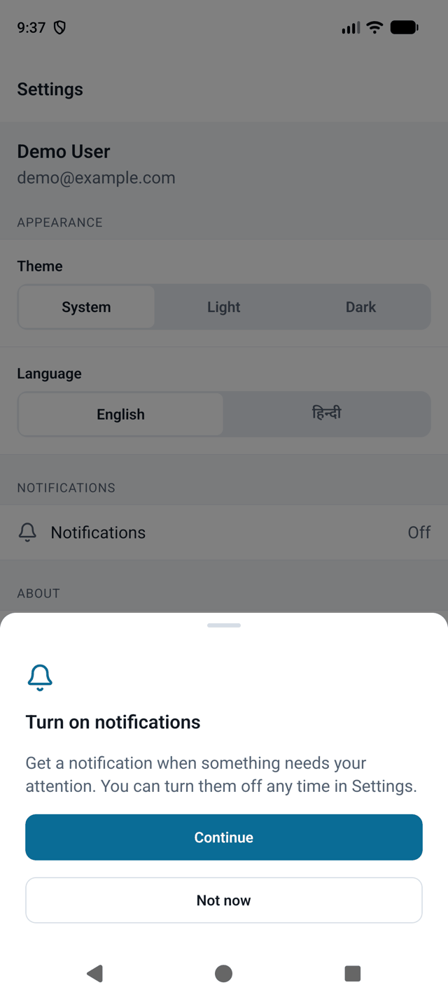
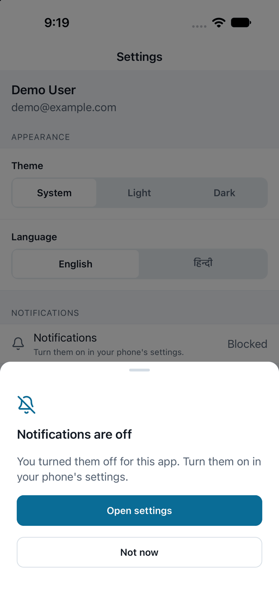

# Permissions

The app explains why it needs a permission before the system asks for it. If someone has already said no
and the system won't ask again, the app tells them how to turn it back on in their phone's settings.

Apple and Google both recommend this: people say yes more often when they know why, and a "Don't allow"
in the system prompt is hard to undo.

<p align="center">
  
  
</p>

Out of the box the app asks for two permissions: notifications, from the Notifications row in Settings,
and the camera, from the Camera button when writing a post ([uploads](uploads.md)). Choosing a photo from
the library needs none: the app uses the system's photo picker. It declares nothing else, so your app
doesn't list location or contacts access it never uses.

## Ask for a permission

Use the `usePermission` hook and render its sheet once on the screen:

```tsx
import { PermissionSheet } from '@/entities/permissions/PermissionSheet';
import { usePermission } from '@/entities/permissions/use-permission';

export function AlertsScreen() {
  const notifications = usePermission('notifications');
  return (
    <>
      <Button title={t('alerts.turnOn')} onPress={notifications.ask} />
      <PermissionSheet {...notifications.sheet} />
    </>
  );
}
```

`ask()` opens the sheet unless the permission is already granted. Pass `onGranted` to carry on with what
the person asked for as soon as it's allowed, straight away or after the system prompt:

```tsx
const camera = usePermission('camera', { onGranted: () => takePhoto() });
<Button title={t('feed.takePhoto')} onPress={camera.ask} />
```

When it isn't granted yet, the sheet shows:

| Status | The sheet shows | Its main button |
| --- | --- | --- |
| `not-determined` | Why the app needs the permission | **Continue** shows the system prompt |
| `denied` | That it's off, and where to turn it on | **Open settings** opens the app's page in the system settings |

`status` is `'unknown'` until the first read, then one of `granted`, `denied` or `not-determined`. The hook
reads it again whenever the app comes back to the foreground, so a change made in the system settings shows
up at once.

Ask when someone reaches for the feature, never at first launch.

## Add another permission

[react-native-permissions](https://github.com/zoontek/react-native-permissions) is installed, built with
the Camera handler only. To add location, contacts or another kind:

1. Add its name to `setup_permissions` in `ios/Podfile`, and its usage string to
   `ios/BareshipApp/Info.plist` (for example `NSLocationWhenInUseUsageDescription`). On Android, add its
   `<uses-permission>` line to `android/app/src/main/AndroidManifest.xml`. Mark each edit with a
   `[bareship]` comment, add a row to [native-changes.md](native-changes.md), then run `pnpm pods`.

2. Add the kind to `PermissionKind` in `src/shared/ports/index.ts`:

   ```ts
   export type PermissionKind = 'notifications' | 'camera' | 'location';
   ```

3. Give it a handler in `src/shared/adapters/native-permissions.ts`, next to `cameraPermission`, and
   register it in `src/shared/services/services.ts`:

   ```ts
   export function locationPermission(): PermissionHandler {
     const permission = Platform.select({
       ios: PERMISSIONS.IOS.LOCATION_WHEN_IN_USE,
       default: PERMISSIONS.ANDROID.ACCESS_FINE_LOCATION,
     });
     return {
       check: async () => toStatus(await check(permission)),
       request: async () => toStatus(await request(permission)),
     };
   }
   ```

   ```ts
   // in createDefaultServices()
   permissions: createPermissions({ notifications: { … }, camera: cameraPermission(), location: locationPermission() }),
   ```

4. Give it its words in `src/entities/permissions/PermissionSheet.tsx` (`COPY`), with an icon from
   `@/shared/ui/icons` and the strings under `permissions` in `en.json` and `hi.json`. TypeScript fails
   until every kind has its copy.

Say plainly what the app does with the permission and when, in a sentence or two. On iOS, the usage string
in `Info.plist` shows in the system prompt too, so keep the two consistent.

`status` can also be `unavailable`: the device can't do it at all (the iOS simulator has no camera). Hide
the control then, as the Camera button does.

If your app doesn't need the camera, remove `'Camera'` from `setup_permissions`, the
`NSCameraUsageDescription` string, `camera` from `PermissionKind` and its handler, then run `pnpm pods`.

## Tests

Swap in a fake with `setServices({ permissions })`. In tests the bottom sheet renders its content without
being opened, so you can press the sheet's buttons directly. `src/entities/permissions/use-permission.test.tsx`
shows the pattern.
