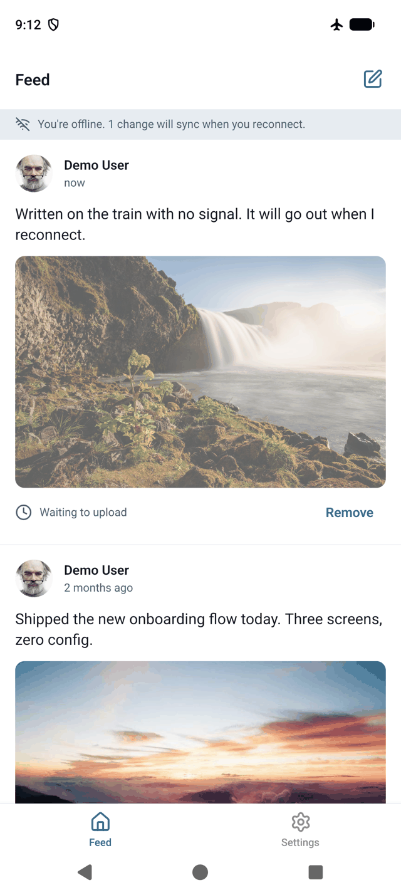
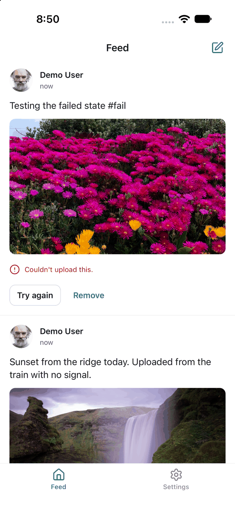

# Photo uploads

Let people add a photo from their library or camera, and have it reach your server even with a bad
connection. You add one with `pnpm gen upload`; this page shows the screen code, how to connect your
backend, and what happens when things go wrong.

What the person using your app sees:

- The photo shows at once, with the upload's progress.
- **Offline**, it waits ("Waiting to upload"), stays through the app being closed, and goes out when the
  phone reconnects.
- **If the connection drops mid-upload**, it waits again instead of failing.
- **If your server refuses it**, it stays as failed, with **Try again** and **Remove**.
- **A retry never stores the photo twice**: every attempt sends the same `Idempotency-Key`.

<p align="center">
  
  
</p>

To see it working, run the app, sign in with the demo account and tap the pen in the feed's header. Turn
on airplane mode before you post to see it wait.

## Before you start

- **No server needed to try it.** The mock backend accepts uploads in development, so the generated code
  works straight away. You connect your API when you're ready ([below](#connect-your-backend)).
- **Photos are resized on the phone** to at most 2048 px on the long side and sent as JPEG (iPhone HEIC
  photos included), so an upload is a few hundred KB.
- **Choosing from the library needs no permission**: the app uses the system's photo picker. The camera
  asks first, with an explanation ([permissions](permissions.md)).
- **Uploads run while the app is open.** They don't continue in the background after it's closed; they
  pick up again the next time it opens.
- **A waiting upload is kept for 24 hours.** After that it's dropped, and its item shows as failed.
- **One photo per upload.** For several, start one upload per photo.

## Add a photo upload to a screen

This example lets people attach a photo of a receipt to an expense.

1. Generate the upload. The path is your API's upload endpoint; each `:param` becomes a field you pass in:

   ```bash
   pnpm gen upload expenses receipt-photo --path /expenses/:id/receipt
   ```

   This adds `useUploadReceiptPhoto()` to `src/features/expenses/api.ts`, with its response schema, a mock
   handler and tests for the online, offline and refused cases. The feature has to exist first:
   `pnpm gen feature expenses` creates one.

2. Use it in your screen:

   ```tsx
   import { PermissionSheet } from '@/entities/permissions/PermissionSheet';
   import { usePermission } from '@/entities/permissions/use-permission';
   import { useUploadProgress } from '@/data/uploads';
   import { Camera, ImagePlus } from '@/shared/ui/icons';
   import { UploadStatus } from '@/shared/ui/upload/UploadStatus';

   import { useUploadReceiptPhoto } from '../api';

   export function ExpenseScreen({ id }: { id: string }) {
     const { t } = useTranslation();
     const upload = useUploadReceiptPhoto();
     const camera = usePermission('camera', { onGranted: () => upload.pick('camera', { id }) });
     const receipt = upload.status({ id }); // null when nothing is waiting or failed
     const progress = useUploadProgress(receipt?.key);

     return (
       <>
         <Button
           title={t('expenses.addReceipt')}
           icon={ImagePlus}
           onPress={() => upload.pick('library', { id })}
         />
         {camera.status !== 'unavailable' ? (
           <Button title={t('expenses.takeReceipt')} icon={Camera} onPress={camera.ask} />
         ) : null}

         {receipt ? (
           <>
             {receipt.localUri ? <Image uri={receipt.localUri} style={styles.receipt} /> : null}
             <UploadStatus
               state={receipt.state}
               progress={progress}
               onRetry={receipt.retry}
               onRemove={receipt.remove}
             />
           </>
         ) : null}

         <PermissionSheet {...camera.sheet} />
       </>
     );
   }
   ```

   `pick` opens the picker (or the camera), keeps the photo on the phone and queues the upload. It
   resolves `false` if the person cancels. `<UploadStatus>` draws the progress bar, "Waiting to upload",
   and Try again / Remove, in every language the app has.

3. Show the stored photo once it's uploaded. `status` returns `null` when the upload is done, so update
   your own data from the server's response: open `src/features/expenses/api.ts` and add `onSuccess`:

   ```ts
   export const useUploadReceiptPhoto = defineQueuedUpload({
     mutationKey: ['expenses', 'receipt-photo'],
     url: ({ id }: { id: string }) => `/expenses/${encodeURIComponent(id)}/receipt`,
     schema: ReceiptPhotoSchema,
     onSuccess: (photo, { id }) =>
       queryClient.setQueryData(expenseKeys.detail(id), expense =>
         expense ? { ...expense, receiptUrl: photo.url } : expense,
       ),
   });
   ```

4. Run `pnpm check`.

**Try it:** open the screen, add a photo, and watch the progress. Turn on airplane mode and add another:
it waits. Close the app, turn airplane mode off and open the app again: it uploads on its own.

## Upload a photo and create a record in one step

When the photo belongs to something you're creating at the same time, such as a post or a new expense,
send both as one write: the photo first, then the record with the photo's URL. If either fails, the whole
thing shows as failed and Try again sends both again.

Add `then` to make the second request. Pass on `idempotencyKey` and `signal`, so a retry is never applied
twice and Remove can stop it:

```ts
export const useCreateExpense = defineQueuedUpload({
  mutationKey: ['expenses', 'create'],
  url: (_expense: NewExpense) => '/uploads',
  schema: UploadSchema,
  id: ({ expenseId }) => expenseId, // so status() and items find it by your id
  then: (uploaded, { expenseId, amount, note }, { idempotencyKey, signal }) =>
    http.post('/expenses', ExpenseSchema, {
      body: { id: expenseId, amount, note, receipt_url: uploaded?.url ?? null },
      idempotencyKey,
      signal,
    }),
  onSuccess: expense => queryClient.setQueryData(expenseKeys.detail(expense.id), expense),
  onError: () => toast.error(i18n.t('expenses.saveFailed')),
});

// In the screen, with a photo the person already picked (or null for none):
await createExpense.start(photo, {
  expenseId: createId(),
  amount: '42.50',
  note,
  createdAt: new Date().toISOString(),
});
```

Variables are strings and are saved with the write, so keep them small: ids and short text, not whole
records. Give the record an id on the phone (`createId()`) so a retry can't create it twice.

A record without a photo goes through the same write: `start(null, …)` skips the upload and runs `then`.

The demo's post composer is built this way: `useCreatePost` in `src/features/feed/api.ts`.

## Show unsent items in a list

`items` lists every upload of that kind that is uploading, waiting or failed, with the `variables` you
passed in. Put them at the top of your list until the server has them:

```tsx
const unsent = useCreateExpense().items;
const rows = [
  ...unsent.map(item => ({ ...item.variables, pending: item })),
  ...expenses.filter(expense => !unsent.some(item => item.id === expense.id)),
];
```

Read progress in the row component with `useUploadProgress(item.key)`, not in the screen, so progress
updates redraw one row instead of the whole list. The demo feed does this (`useUnsentPosts` and
`PostCard`).

Unsent items are saved on the phone apart from your list's data, so a refresh of the list never hides
them.

## Connect your backend

Each upload is one request, or two with `then`, and every request carries an `Idempotency-Key` header
that stays the same on every retry.

**The upload:** `POST` to your path as `multipart/form-data`, with the photo in a field named `file`.
Return the stored file, for example:

```json
{ "id": "rcpt_81", "url": "https://cdn.example.com/receipts/rcpt_81.jpg" }
```

Change the fields in the generated `schema.ts` to match. If your API uses another field name, set
`field: 'photo'`.

**Retries:** when you get a key you've seen before, return the first response instead of storing the file
again. The app retries after a timeout or a dropped connection, and the first attempt may have reached
you.

**Refusing an upload:** return a 4xx error, such as 413 for a file that's too big or 422 for one you won't
accept. The app shows it as failed and calls `onError`; it doesn't retry. 5xx errors and timeouts are
retried.

**Then point the app at your API:** set `API_URL` and `API_MOCKS=false` in the environment's `.env` file
([going live](going-live.md#use-your-api)), and make the mock in `src/mocks/<feature>.ts` answer like your
server, so tests keep matching.

**Storage behind a presigned URL** (S3, R2, Google Cloud Storage): `defineQueuedUpload` sends the photo to
your API. To send it straight to storage, write a `defineQueuedMutation` that asks your API for the URL,
uploads with `uploadFile`, then saves the record. Keep the same `retry` and `writeSignal` handling as
`defineQueuedUpload` in `src/data/uploads.ts`.

## What happens when something goes wrong

| What you see | Why | What to do |
| --- | --- | --- |
| "Couldn't upload this." with Try again | Your server refused it (a 4xx error), or it kept failing | Check your API's response. In development, the demo refuses any post containing `#fail` |
| "Waiting to upload" doesn't go away | The phone is offline, or can't reach `API_URL` | It sends as soon as the connection is back. Check `API_URL` if the phone is online |
| An upload shows as failed after the app was closed | It was mid-upload when the app closed, so it couldn't finish | Tap Try again; it reuses the same key, so nothing is stored twice |
| An upload disappeared after a day offline | Waiting uploads are kept for 24 hours | Shorten the time offline, or raise `maxAge` in `src/data/persister.ts` |
| Fails with code `file_missing` | The kept photo was deleted (the app's data was cleared) | Remove it and pick the photo again |
| No Camera button | The device has no camera (the iOS simulator has none) | Expected; test the camera on a phone |

A waiting upload only goes out for the account that made it. If someone else signs in on the same phone,
it's dropped, not sent with their account.

## Remove uploads from your app

If your app doesn't need photo uploads:

1. Run `pnpm strip-examples` if you haven't, to remove the demo feed.
2. Remove the camera, as the [permissions guide](permissions.md#add-another-permission) describes.
3. Uninstall the libraries, then delete their adapters (`image-picker-photo-picker.ts`,
   `file-access-file-store.ts`) and the `photos` and `files` entries in `src/shared/services/services.ts`:

   ```bash
   pnpm remove react-native-image-picker react-native-file-access
   ```

4. Run `pnpm pods` and `pnpm check`.

## Reference

`defineQueuedUpload(options)`, in `src/data/uploads.ts`, returns a hook. Call it at module level in your
feature's `api.ts`, and import that module from `src/app/queued-writes.ts` (the generator does both).

| Option | What it does |
| --- | --- |
| `mutationKey` | Names the upload in the saved queue. Keep it the same across app versions |
| `url(item)` | Where to send the photo |
| `schema` | Checks and types the server's response |
| `field` | The multipart field name. Default `file` |
| `photo` | `{ maxSize, quality }` for `pick`. Default 2048 px, 0.8 |
| `id(item)` | How `status` and `items` identify an item. Default: all its variables |
| `then(uploaded, item, { idempotencyKey, signal })` | A second request after the upload |
| `onSuccess(data, item)` | The server has it: update your data |
| `onError(error, item)` | The server refused it; the item already shows as failed |
| `onMutate(item, localUri)`, `onRemove(item)` | Show an item somewhere else at once, and take it away again |

| The hook returns | |
| --- | --- |
| `pick(source, item)` | Picks (`'library'` or `'camera'`), keeps and queues the photo. Resolves `false` on cancel |
| `start(photo \| null, item)` | Queues a photo you already have, or none |
| `status(item)` | That item's upload, or `null` when there's nothing unfinished |
| `items` | Every unfinished upload of this kind for the signed-in account |

| An item has | |
| --- | --- |
| `state` | `'uploading'`, `'waiting'` or `'failed'` |
| `key` | Pass to `useUploadProgress(key)` for progress (0–1) |
| `localUri` | The photo on the phone, to show before the server has it |
| `variables` | What you passed to `pick` or `start` |
| `retry()`, `remove()` | Try again with the same key; stop it, drop it and delete the photo |

### Native setup

| Library | Why |
| --- | --- |
| `react-native-image-picker` | The system photo picker and camera, with resizing on the phone |
| `react-native-file-access` | Keeps photos in the app's documents folder until they're uploaded |
| `react-native-permissions` | The camera's permission state on iOS (Android needs none) |

iOS needs `NSCameraUsageDescription` in `Info.plist`. Android declares no new permission, because the photo
is taken by the system camera app. See [native changes](native-changes.md#photo-uploads).
